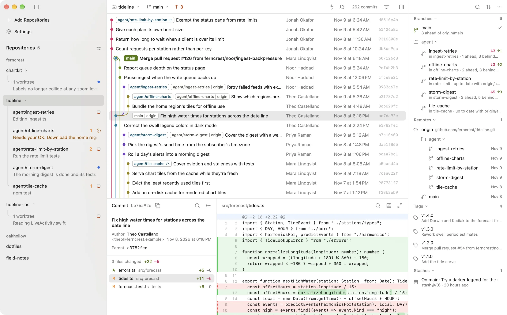

<h1 align="center"><br>Roga</h1>

<p align="center">
  <strong>Rather Opinionated Git App</strong><br>
  A fast, native Git client for the Mac, made for reviewing what your agents wrote.
</p>

<p align="center">
  <a href="https://roga.sh">Website</a> ·
  <a href="https://roga.sh/download">Download</a> ·
  <a href="VISION.md">Vision</a> ·
  <a href="ROADMAP.md">Roadmap</a> ·
  <a href="ARCHITECTURE.md">Architecture</a>
</p>

<picture>
  <source media="(prefers-color-scheme: dark)" srcset="site/public/shots/window-dark.webp">
  
</picture>

Other Git clients were built for people clicking through Git. Today you're more likely to be watching agents work in parallel worktrees and reviewing what they did. Roga is a Mac app built for that. It's written in Swift, it's free, and all of the code is here.

## What it does

- **Shows what every agent is doing.** Each worktree has a row in the sidebar. Install the hooks for Claude Code or Codex from Settings, and that row says whether its agent is working, finished or waiting for your OK.
- **Reviews a branch like a pull request.** You get the commits since it left main and one combined diff, with the changed words highlighted.
- **Asks the agent you already have.** Claude Code or Codex can resolve a merge conflict, write a commit message or work out why Git refused a command. They use the sign-in you already have, so there are no API keys, no AI add-on to pay for, and no limits from Roga.
- **Stays fast on huge repositories.** Roga reads Git's commit-graph file directly and loads only the rows on screen. Checking out a branch in the Linux kernel [takes about 0.4 seconds](docs/performance/README.md).
- **Leaves Git in charge.** It runs the Git you already have and keeps no hidden state, so you can drop to the command line at any moment.
- **Plays your history back.** Roga can replay a branch as a metro map, ending on a poster of what the team got done, and save it as a video or an image. This one is on `main` and coming in the next release.

## Installing

Roga needs macOS 26 or later. Download it from [roga.sh](https://roga.sh), or install it with Homebrew:

```bash
brew install --cask tmarkovski/roga/roga
```

It keeps itself up to date with Sparkle.

## Finding your way around

If you're curious why Roga works the way it does, these are the places to start:

| Read | To find out |
| --- | --- |
| [VISION.md](VISION.md) | What Roga is trying to be, and what it deliberately won't be |
| [ROADMAP.md](ROADMAP.md) | The order of the work, and what's coming next |
| [ARCHITECTURE.md](ARCHITECTURE.md) | How the app is put together |
| [docs/decisions](docs/decisions/README.md) | The decisions behind it and what was weighed for each one |
| [docs/performance](docs/performance/README.md) | What's been measured and improved |
| [site](site/README.md) | The landing page at roga.sh |

Almost all of the code is in the [RogaKit](RogaKit/Sources) package. A few good places to start reading:

- [`CommitGraph`](RogaKit/Sources/CommitGraph) reads Git's commit-graph files, orders history and lays out the graph.
- [`RepositoryEngine`](RogaKit/Sources/RepositoryEngine) keeps one session per repository, loading history, status and diffs, and watching the file system.
- [`HistoryUI`](RogaKit/Sources/HistoryUI) and [`DiffUI`](RogaKit/Sources/DiffUI) draw the commit list and the diff view.
- [`AgentHooks`](RogaKit/Sources/AgentHooks) and [`AgentEngine`](RogaKit/Sources/AgentEngine) are how Roga hears from Claude Code and Codex and runs them.
- [`RogaUI`](RogaKit/Sources/RogaUI) holds the windows, the sidebar and the models that connect them to everything above.

If something's broken or missing, [open an issue](https://github.com/tmarkovski/roga/issues).

## Building

Roga needs macOS 26 or later and Xcode 27.2, which is the first version to create projects in the JSON format that `Roga.xcodeproj` uses. Open `Roga.xcodeproj` and run the Roga scheme. Development builds are signed to run on your own Mac, so you don't need a developer account.

You can build and test the RogaKit package without the Xcode project:

```bash
swift test --package-path RogaKit
```

## License

Roga is licensed under the [Apache License 2.0](LICENSE).
