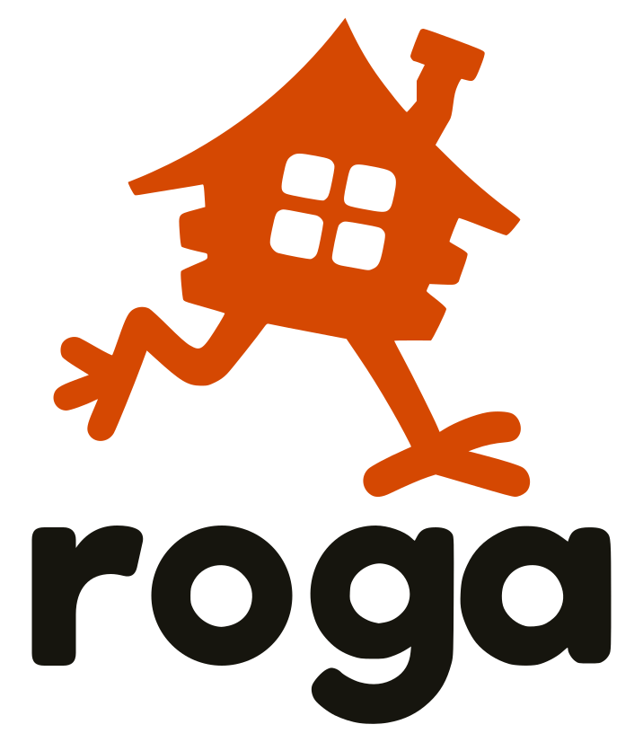

# Design exploration

This directory keeps design explorations and their editable assets in version control.

## Initial branding — November 2, 2026

Two names were explored for the app:

| Name | Expansion |
| --- | --- |
| Yaga | Yet Another Git App |
| Roga | Rather Opinionated Git App |

Both options used the same house on chicken legs. The house leans into a walking stride, with a compact pointed roof and rounded feet. The mascot originated with the Yaga name and its association with a witch's walking house. Roga keeps the mascot and changes only the wordmark.

We chose Roga on November 4, 2026 ([decision 34](../decisions/0034-name-the-app-roga.md)). The Yaga logos and wordmark are no longer in this directory, and commit `a285d8d` has them.

### SVG assets

| Asset | File |
| --- | --- |
| Full logo | [Color](branding/roga-logo.svg) |
| Full logo in one color | [Monochrome](branding/roga-logo-monochrome.svg) |
| Wordmark only | [Color](branding/roga-wordmark.svg) |
| The house alone | [Color](branding/roga-mark.svg) |
| The house alone in one color | [Monochrome](branding/roga-mark-monochrome.svg) |

All SVGs use editable paths and transparent backgrounds. Lettering is outlined and requires no fonts. The window panes and letter counters are transparent cutouts. The Roga logo retains the original house path, size and placement, reuses the **g** and **a** outlines from the Yaga wordmark, and adds matching **r** and **o** shapes.

The current colors are orange `#D54802` and dark ink `#16150E`. Monochrome files use `currentColor`, which defaults to black. Set CSS `color` when embedding them inline, or change the fill in the file when using them through an image element.

The SVGs in `branding/` are the saved designs for this exploration. Earlier generated concept boards and working scripts remain in the ignored `output/` directory and are not required to use these assets.

## Animating the house — November 3, 2026

The mark is one path, so it can't move its legs. For animating, the house is split into a body and two legs ([decision 21](../decisions/0021-draw-the-houses-animations-from-joints.md)).

[`branding/roga-house-body.svg`](branding/roga-house-body.svg) is the body: the mark's own outline with the legs cut off, closed across the two places where they join it, in the same coordinates as the mark. `HouseOutline.swift` and the landing page's `site/public/index.html` hold the same path. If the mark's house changes, all three have to be cut again.

The legs aren't artwork. The app draws each one from joints, which are a hip, a knee, a hock, an ankle and three toes, as lines with round ends. `HousePose.mark` places those joints in the stride the mark is drawn in, closely enough that it reads as the logo, but it isn't a trace.

To add an animation, write a `HouseMotion` in `RogaKit/Sources/RogaUI/House/` that returns a pose for any moment, and add a case for it to `HouseAnimation`. It then appears in Settings and in Window > House Animations with the others, and the tests check that it loops without jumping and fits inside the frame. That window shows each animation large, with its joints, at its real sizes, and with its own pause, speed and frame slider.

## Icons — November 3, 2026

The app's icons start as SVGs in [`icons/`](icons/). They're drawn with strokes on a 24-by-24 grid. `icons/lucide/` holds unchanged copies from [Lucide](https://lucide.dev), and each file's first line says which release it came from. `icons/roga/` holds our own, drawn to match. `Scripts/generate-icons.swift` turns all of them into custom symbols and names them in code ([decision 24](../decisions/0024-icons-as-custom-symbols-from-lucide.md)).

To add an icon:

1. Copy its SVG into `icons/lucide/`, from lucide.dev or from `icons/` in the `lucide-static` npm package, or draw one on the same grid in `icons/roga/`. In that package, `tags.json` is the way to search, as for `git` or `version control`. Use a name from its `icon-nodes.json`, because other files in `icons/` are aliases of those, which Lucide can rename or remove.
2. Run `Scripts/generate-icons.swift`. It stops with a message if a file has something it doesn't know how to draw.
3. If the icon stands for something in Roga, name it in `RogaKit/Sources/IconUI/Icon.swift`, so that the thing looks the same everywhere.

Lucide's `git-pull-request` icons mean a pull request on a hosting site. `git pull` is `arrow-down-to-dot`, which `Icon.swift` calls `Icon.pull`.

## App icon — November 4, 2026

The app's icon is the house from [`branding/roga-mark.svg`](branding/roga-mark.svg), in orange on the landing page's paper color, `#FAF6EE`, the way the page's `apple-touch-icon.png` already draws it. In dark mode the paper becomes the ink color, `#16150E`, as the page's background does.

The icon is in [`App/AppIcon.icon`](../../App/AppIcon.icon), in the format that Icon Composer saves, rather than as a set of PNGs in an asset catalog. Roga requires macOS 26 ([decision 2](../decisions/0002-minimum-macos-26.md)), and with this format the system draws the glass and the dark, clear and tinted versions from one SVG. Xcode also writes an `.icns` file into the app for anything that still reads one.

The SVG in that folder is a copy of the mark, so a change to the mark has to be copied there too. To adjust the icon itself, such as the size of the house or its colors, open `App/AppIcon.icon` in Icon Composer, which comes with Xcode.

## Settings — November 5, 2026

Wireframes for a larger Settings window with pages, including the agents Roga can call to write commit messages and the hooks that tell it when an agent is working. [`settings/README.md`](settings/README.md) describes them, and [`settings/boards.py`](settings/boards.py) draws the boards on the design canvas.

## A second line in the sidebar — November 6, 2026

Boards for a second line under a sidebar row while an agent works, waits or has finished, or a worktree stopped partway. We chose to show it only while there's something to say ([decision 48](../decisions/0048-a-second-line-under-a-sidebar-row-while-theres-something-to-say.md)). [`second-line/README.md`](second-line/README.md) describes the boards, and [`second-line/boards.py`](second-line/boards.py) draws them on the design canvas. The app has since moved the mark to the right of the row and given how long its own place at the line's end ([decision 51](../decisions/0051-marks-at-the-right-of-a-sidebar-row-and-names-that-fade.md)), which the boards don't draw.
