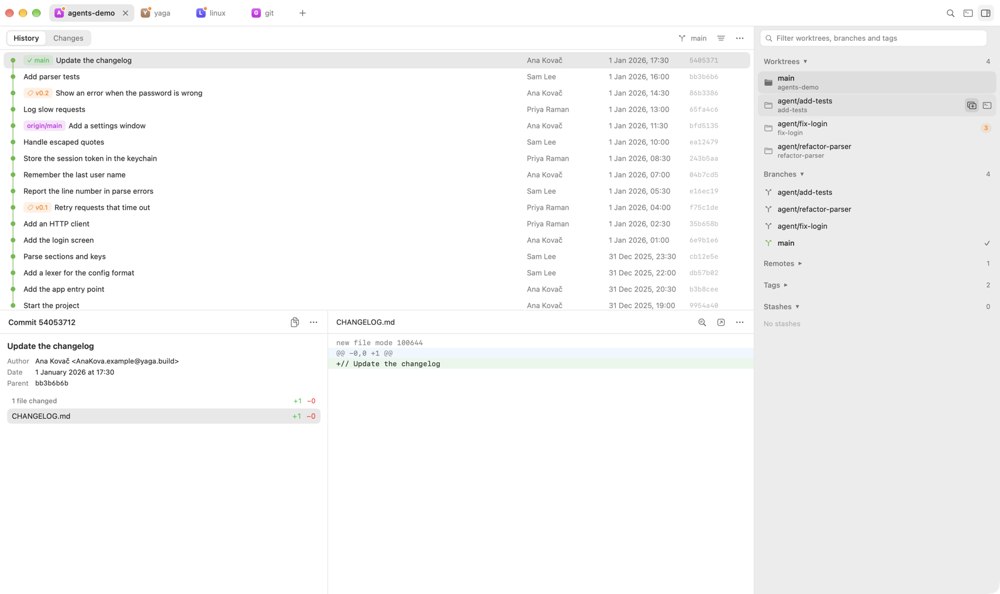

# Main window

This is the rough wireframe of yaga's main window for release 1. It settles the overall layout. Details will change as we build the real views. The [main window preview](../prototypes/main-window/README.md) shows this layout with real repositories, and you can run it to try the tabs and panels.

The layout follows the Claude app. The repository tabs have the top row to themselves, every section below them is a plain rectangle with its own header, and a navigator on the right, a shade darker than the rest, lists what's in the repository.



```text
┌──────────────────────────────────────────────────────────────────────────────────────┐
│ ● ● ●  [A agents-demo ×] [Y yaga] [L linux] [G git]  +                    ⌕  ▤  ◨    │
├───────────────────────────────────────────────────────────────┬──────────────────────┤
│ ( History | Changes 3 )                      ⑂ main   ≡  ⋯     │ ⌕ Filter             │
├───────────────────────────────────────────────────────────────┤ Worktrees ▾       4  │
│ ●  ✓ main  Update the changelog     Ana Kovač  1 Jan  5405371  │   main               │
│ ●  Add parser tests                 Sam Lee    1 Jan  bb3b6b6  │   agent/add-tests  4 │
│ ●  v0.2  Show an error when …       Ana Kovač  1 Jan  86b3386  │   agent/fix-login  3 │
│ …                                                              │ Branches ▾        4  │
├─────────────────────────┬─────────────────────────────────────┤ Remotes ▸         1  │
│ Commit 54053712   ⧉  ⋯   │ Sources / App / Login.swift  ⌕ ↗ ⋯   │ Tags ▸            2  │
├─────────────────────────┼─────────────────────────────────────┤ Stashes ▾         0  │
│ Update the changelog     │ @@ -3,3 +3,4 @@                      │                      │
│ Author, date, parent     │   unchanged line                     │                      │
│ 1 file changed  +1 −0    │ + added line                         │                      │
│ CHANGELOG.md     +1 −0   │                                      │                      │
└─────────────────────────┴─────────────────────────────────────┴──────────────────────┘
```

## The tab bar

The tab bar is the top row of the window, next to the traffic lights, and nothing sits above it. It holds one tab for each open repository (decision 10).

- A tab shows the repository's icon and name. When the tab shows a linked worktree rather than the main one, the name includes the worktree, as in `agents-demo · fix-login`.
- The selected tab has a soft gray fill. Its close button is always visible, and the other tabs show theirs when the pointer is over them. The close button is a thin, dark X that gets a rounded gray square when the pointer is over it, in the same style as every icon button.
- The icon gets an orange dot when any of the repository's worktrees has uncommitted changes. The tab's tooltip shows the repository's path and which worktrees have changes.
- Tabs are as wide as their titles, up to a maximum.
- A plus button after the last tab opens a repository in a new tab.
- The right end of the bar holds buttons that apply to the whole window: search (after the release 1 cut line), the log of git commands yaga ran (later), and showing or hiding the navigator.
- Dragging the empty part of the bar moves the window, and double-clicking it does what the user chose in System Settings.
- The keyboard shortcuts are Command-T for a new tab, Command-W to close the tab, Control-Tab and Control-Shift-Tab to move between tabs, and Command-1 to Command-9 to jump to a tab. Moving a tab to a new window is in the Window menu and the tab's context menu.

## Panels

Below the tab bar, every section is a panel: a plain rectangle with a 40-point header, separated from its neighbors by thin lines rather than cards or shadows.

- The left side of a header holds sub-tabs or a title.
- The right side holds the panel's commands as icon buttons with tooltips. An icon button is a thin, dark glyph that gets a rounded gray square when the pointer is over it, like the Claude app's. Every command is also in a menu and has a keyboard shortcut.
- Dragging the lines between panels resizes them.

## The history panel

The history panel fills the top of the window, left of the navigator.

- A segmented switch, styled like the Claude app's switch between chat and code, chooses between **History** and **Changes**. The selected segment is raised in white on a gray track, and Changes shows how many uncommitted files the current worktree has. A segmented switch suits two or three views of the same panel. If more views join them, sub-tabs would scale better.
- The right side of its header shows the current worktree's branch, a button for choosing which branches the history shows, and a menu for more commands.
- **History** lists commits with the graph, then the commit's refs as colored badges, its subject, author, date and short hash. The current branch is green with a checkmark, local branches are blue, remote branches are purple, and tags are orange.
- **Changes** lists the current worktree's uncommitted files, each with a status letter, its name and its folder.

## The commit and diff panels

Two panels sit under the history panel.

- **The commit panel** shows the selected commit: its subject and message, author, date and parents, and the files it changed with the lines added and removed in each. Its header shows the short hash and a button that copies the full hash.
- **The diff panel** shows the selected file's changes as a unified diff without wrapping, with backgrounds for added lines, removed lines and hunk headers. Its header shows the file's path, with the folders in gray and the file name in full color, and buttons for finding text, opening the file in an editor, and more. Line numbers and highlighted changed words come with the TextKit 1 view (decision 9).
- In **Changes**, the commit panel is hidden and the diff panel takes the full width.

## The navigator

The navigator is the panel on the right. It's a shade darker than the other panels, like the Claude app's sidebar, and it can be hidden from the tab bar.

- A filter field at the top narrows every section at once.
- Its sections are **Worktrees**, **Branches**, **Remotes**, **Tags** and **Stashes**. A section's header shows its title with a small triangle after it, and clicking the header collapses or expands the section.
- Rows show their status at rest and their commands when the pointer is over them. A section header shows how many items it has, and on hover it shows the section's commands instead, such as sorting and filtering, or creating a branch or tag in release 2.
- A worktree row shows its branch, its folder and the number of uncommitted files. On hover, the count gives way to buttons that open the worktree in a new tab or in Terminal. Clicking the row switches the tab to that worktree.
- The current branch has a checkmark.

## Colors and type

- Surfaces are plain, with thin gray lines between sections. The navigator is a shade darker. Dark mode keeps the same structure in dark grays.
- Selection is a soft gray fill, not the accent color. The accent color is kept for the graph.
- Text uses the system font at 12.5 to 13 points. Hashes and diffs use the monospaced system font.

## Still open

- Where branch review, file history and the contents of a stash appear. They could be more sub-tabs of the history panel, or modes of the whole tab.
- What the tab bar does when the tabs don't fit.
- The repository icon. The preview uses a colored square with the repository's initial.
- How wide the commit panel is by default, and whether it can be hidden.
